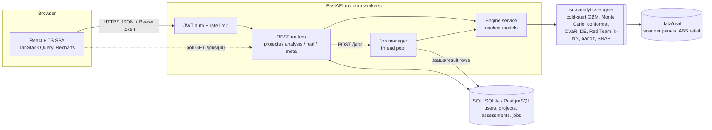

# Architecture

## Decisions
* **Engine stays pure Python** (`src/`), unchanged by the web layer; both the API and the tests call it directly. The service layer (`backend/app/services/engine.py`) is the only place that knows about both.
* **Assessments are immutable snapshots**, keyed by an input hash. Editing a plan marks the latest snapshot *stale* instead of silently changing history.
* **Long computations are jobs.** The optimiser (≈15 s), Red Team (≈25 s) and Sobol (≈10–40 s) exceed what a request thread should hold. Jobs are DB rows (`queued -> running -> done|failed`), polled by the UI, and orphaned jobs are failed on start-up (`prestart`), so a refresh or crash never loses track of work. Swapping the thread pool for Celery/RQ only changes `jobs.submit`.
* **Migrations are code** (Alembic) and run on start-up; Docker runs them once in `prestart` before the workers boot to avoid races.
* **Security**: bcrypt (cost 12), HS256 JWT with expiry, per-IP auth rate limit, uniform login error (no user enumeration), 404-not-403 for other users' resources, strict request validation, no stack traces in job errors, `SECRET_KEY` mandatory in prod.
* **Observability**: JSON access logs with request ids (`X-Request-ID`), `X-Process-Time-ms`, `/api/health`, `/api/metrics`.
* **Frontend**: route-level code splitting, typed API client with central 401 handling, server state in TanStack Query (cache + invalidation), a `useJob` hook for start-and-poll.

## Scaling notes
Stateless API workers scale horizontally; models are read-only per process. Per-process pieces to externalise first: the auth rate limiter and job executor (Redis + worker), and the JWT-in-localStorage session (httpOnly cookie).
